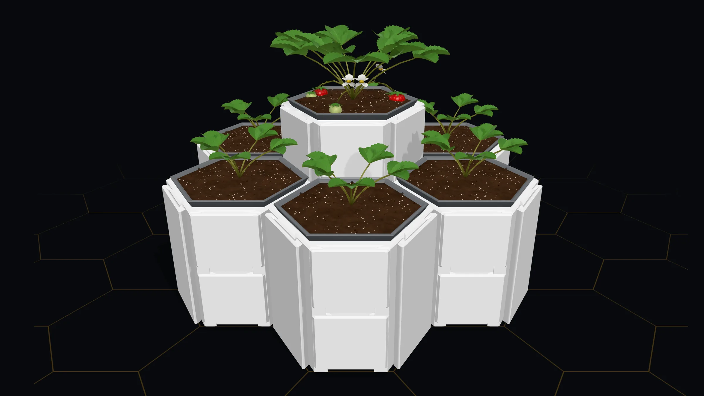
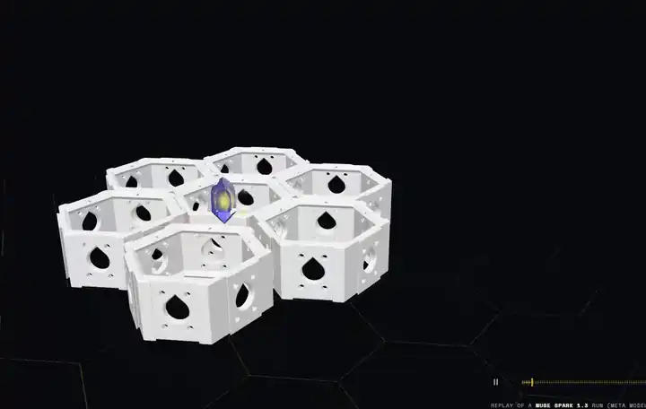
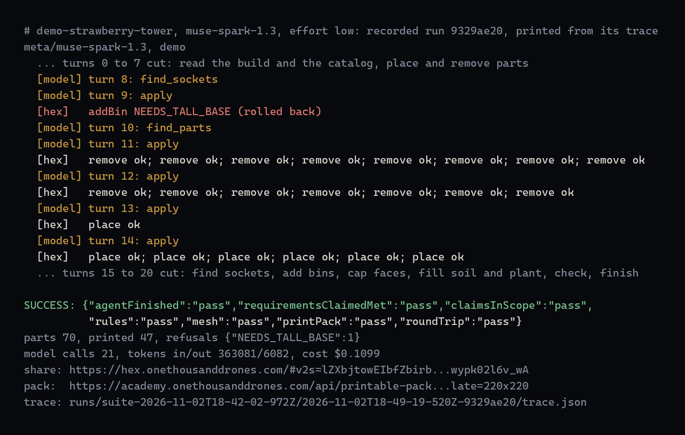
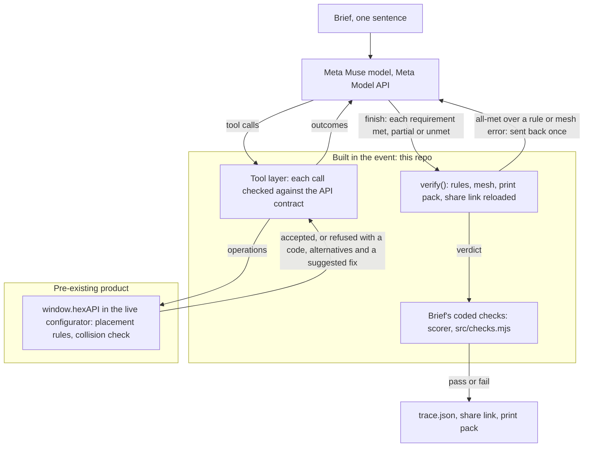

<p align="center">
  
</p>
<p align="center"><sub>Built by Muse Spark 1.3 from one demo brief (run 9329ae20), reloaded from its share link and drawn by the configurator's own <code>still()</code>, November 2026 · that brief passed 5 of 5 runs in its demo suite</sub></p>

# hex-agent

An agent on Meta Muse models that turns one sentence into a checked Hex Cluster build in the live configurator.

**Live** · [hex.onethousanddrones.com](https://hex.onethousanddrones.com) (the pre-existing configurator the agent drives) · **Docs** · [paper (PDF)](docs/paper/hex-agent-paper.pdf) · **Status** · active

## What it does

You give it a brief such as "a strawberry tower for a small balcony". A Meta model reads the build, asks the configurator where parts fit, places them through the public [`window.hexAPI`](https://academy.onethousanddrones.com/hex/api), reads each accept or refusal and the alternatives it offers, and revises. It ends with a share link, a parts list, a print pack the configurator made, and the model's own statement of which requirements were met, partly met or not met. The configurator's checks and our code then decide whether the run passed.

<p align="center">
  
</p>
<p align="center"><sub>Run 9329ae20 replayed on hex.onethousanddrones.com (<code>?replays</code>, no model running), 54 s of the replay at 5.4x, recorded November 2026</sub></p>

## What was built during the hackathon

Hex Cluster, its configurator, placement rules, collision check, `window.hexAPI`, print packs and part catalog existed before the event and belong to One Thousand Drones; none of that source is here. One Thousand Drones also shipped configurator releases during the event, some prompted by the agent's runs; they are product changes, not claimed here, and every result ran on one of them (each identified by its API-contract hash). This repository, from its first commit (`fb78560`, 2026-10-27), is the event work: the agent loop, browser bridge, checked tool layer, Meta model adapters, verification, honesty check, abstention, grader and rescoring, spend ledgers, evaluation suites, baselines, the replay tool and a vision judge on Meta models. Nothing was trained. [HACKATHON_DELTA.md](HACKATHON_DELTA.md) names each pre-existing version.

Pre-existing things the agent and its demo use, and their setup:

- **The Hex Cluster configurator** at [hex.onethousanddrones.com](https://hex.onethousanddrones.com) (One Thousand Drones, proprietary). Hosted and public: nothing to install, `npm start` opens it in Chrome. Its API description is vendored in [`contract/`](contract/) so the tool layer can check calls offline.
- **The agent crystal** shown in the configurator during the demo, from [Otd-llc/emotive-hex-agent](https://github.com/Otd-llc/emotive-hex-agent) (MIT; the Emotive Engine by Joshua Tollette, imported at its pre-event commit `56e0bcaf`). It is served by the hosted configurator; hex-agent does not import it, and it is not entered for judging.
- **Meta's models**: the Meta Model API (a key in `MODEL_API_KEY`, see [Run it](#run-it)) and, for the open-weights development batches, Muse Spark Open ([Built with Muse Spark Open](https://huggingface.co/meta-models/Muse-Spark-Open-816B-A42B)) on Baseten, Fireworks or a Modal Dedicated endpoint, each with its own key.

## Run it

Needs Node 22 or later (`npm test` passes a glob to `node --test`, which needs Node 21 or later), Google Chrome, and, for live runs only, a Meta Model API key in `MODEL_API_KEY`.

Without a key:

```sh
npm install
npm test                      # unit tests, no network
npm run mock-e2e              # the whole loop on the live configurator, scripted model
node bin/replay.mjs runs/suite-2026-11-02T18-42-02-972Z/2026-11-02T18-49-19-520Z-9329ae20/trace.json
```

`npm run mock-e2e` drives the live configurator with a scripted model and runs every check. `bin/replay.mjs` re-applies a recorded run (here the strawberry tower) on the live configurator, accelerated and labelled REPLAY, and calls no model.

With a key:

```sh
cp .env.example .env          # put MODEL_API_KEY in it
META_API_ALLOWED=1 npm start -- --model=muse-spark-1.3 --effort=low "a portable electronics organizer with removable bins and a carry handle"
```

On Windows PowerShell: `$env:META_API_ALLOWED=1; npm start -- --model=muse-spark-1.3 --effort=low "..."`.

`npm start` opens a visible Chrome window on the configurator so you can watch the build change, prints each model turn and each configurator outcome, then the verdict, the share link, the print-pack link and the trace path (`runs/<run-id>/trace.json`).

Flags: `--model=<id>` (required; `muse-spark-1.3` or `muse-wonder-1.0` on the Meta Model API), `--effort=low` (the code's Meta default is medium; every reported effort-low run set `--effort=low` explicitly), `--max-turns=30`, `--max-usd=3`, `--purpose=dev|eval|demo`, `--headless`, `--features=...`.

<details>
<summary>Features and Muse Spark Open hosts</summary>

| `--features` | Default | What it does |
| --- | --- | --- |
| `abstain` | on | declines a brief that should not be built as asked, or builds only its safe part and reports the rest unmet |
| `acceptance` | off | writes checkable requirements before the first change; code sends back a "met" whose own test fails |
| `rolegraph` | off | `plan_build`: the build as a role graph bound to configurator offers |
| `cites` | off | checks that a finish cites parts that exist |
| `ewDrawers`, `rollbackRead`, `topology`, `verify` | on | fixes 1 to 4: slide drawers offered on east- and west-facing half bases; the model told when a batch was rolled back; base groups and touching walls in the build summary; an all-met finish over a rule or mesh error sent back once ([EVALUATION.md](EVALUATION.md)) |

A plain list (`--features=abstain,acceptance`) sets the behaviour features; `none` turns them all off. The four fixes stay on unless switched off: `--features=-topology`.

Muse Spark Open: `--model=meta-models/muse-spark-open-1026` (Baseten), `accounts/fireworks/models/muse-spark-open` (Fireworks) or `modal-dedicated:<endpoint host>` (Modal Dedicated, GPU-billed, opens only with `MODAL_DEDICATED_ALLOWED=1` on the command line). Modal Shared ids (`modal:<endpoint host>`) are refused. Each host has its own key, credit and ledger in `.spend/`.

</details>

<p align="center">
  
</p>
<p align="center"><sub>Run 9329ae20's recorded trace printed in <code>bin/run.mjs</code>'s console format, November 2026 (turns 0 to 7 and 15 to 20 cut, links shortened). The configurator refuses a bin, the model rebuilds, and the run passes all seven checks.</sub></p>

## What's inside

| Path | What it is | Reach for it when |
| --- | --- | --- |
| [`bin/run.mjs`](bin/run.mjs) | one brief, end to end (`npm start`) | you want to watch a build |
| [`bin/suite.mjs`](bin/suite.mjs) | a brief set, repeated, scored | you want a pass rate |
| [`src/`](src/) | agent loop, bridge, tools, checks, model adapters, ledgers (frozen at `eval-final`) | you change the agent |
| [`evals/`](evals/) | brief sets and their coded checks | you add a brief |
| [`runs/`](runs/) | every suite's traces, summaries and rescore files | you audit a result |
| [`bin/replay.mjs`](bin/replay.mjs) | re-applies a recorded run on screen, labelled REPLAY, no model | you film a real run again |
| [`bin/smoke-tools.mjs`](bin/smoke-tools.mjs) | every tool against the page, no model | the configurator just deployed |
| [`docs/submission/paper/`](docs/submission/paper/) | paper, report, addendum, claim ledger | you check a number |

## How it works



<p align="center"><sub>Mermaid, drawn from the calls in <code>src/agent.mjs</code>, <code>src/tools.mjs</code> and <code>src/session.mjs</code> at <code>eval-final</code>, November 2026. GitHub draws it in your theme.</sub></p>

The model plans and chooses. The configurator's rules and collision check accept or refuse each change. The configurator's checks and our code decide the run. A requirement with no coded check rests on the model's own statement, which is why "met" claims are screened. Some placements are not the model's choice: when the configurator refuses an operation, the tool layer's helpers re-send the configurator's suggested fix once, unasked. [ARCHITECTURE.md](ARCHITECTURE.md) has the parts.

## Results

Every agent result below is a Meta model. On the frozen agent (tag [`eval-final`](https://github.com/Otd-llc/hex-agent/tree/eval-final)), Muse Spark 1.3 through the Meta Model API, reasoning effort low, configurator contract `da0834cc`:

| Set | Passed | 95% interval | Read it as |
| --- | --- | --- | --- |
| 18 held-out briefs, one pre-committed run | 14/18 (77.8%) | 54.8 to 91.0% (Wilson) | 11 builds and 3 declines of briefs written to be refused; these passes were not audited |
| Same 18, an agent that leaves the build as it finds it | 4/18 | | the floor: it passes only by declining or reporting unmet |
| 36 development briefs, five runs each | 173/180 | 90.7 to 100% (clustered) | a development-set rate, optimistic: we fixed failures on these briefs |

The 14 of 18 likely overstates success. Its passes were not audited, and audits of the same checks on the development briefs and on a second held-out set (the [addendum](docs/submission/paper/addendum.md)) found passing builds that miss a requirement no check tests: a false pass on 4 of 36 audited development briefs (Claude reviewer agents, hand-tabulated, not blinded; 2 more unsure).

A pass means the build is valid in the configurator (placement rules, mesh collision check, print pack, share link reloaded with the same parts list) and passes the brief's coded checks. A decline that leaves the build empty needs a finish and no broken rule, and the brief's checks still apply; warning-level issues pass; a requirement reported unmet passes unless the brief checks for it. Where a prop sits, which way a part faces in plan and whether one part reaches another are not tested, and nothing was printed.

A development build cost about $0.057 of Muse Spark 1.3 tokens on average per run (the pictured demo run cost more), a list-price estimate with no bill behind it. After the paper's first review gate, Muse Wonder 1.0 passed 17 of 18 held-out briefs on its one run (Wilson 74.2 to 99.0%). Earlier, Meta's open-weights Muse Spark Open ([Built with Muse Spark Open](https://huggingface.co/meta-models/Muse-Spark-Open-816B-A42B), under the Muse Model License) passed 89.4 to 93.9% of development runs per batch in seven effort-low batches on Baseten and a Modal Dedicated endpoint. The models are reported apart and never pooled or compared. The grader is ours, on one product, reviewed by no third party. Details, intervals and every caveat: the [paper](docs/submission/paper/paper.md).

## Notable engineering

- **The configurator and our code grade the run, the model only reports.** A model's "done" is a claim. `verify()` requires the placement rules, the mesh collision check and the print pack to pass and reloads the share link in a fresh tab to compare the parts list; the suite scorer then runs the brief's coded checks in `src/checks.mjs`, and a check that did not run counts as failed. Measured limit: false passes on 4 of 36 audited development briefs. [`src/agent.mjs`](src/agent.mjs), [`src/checks.mjs`](src/checks.mjs)
- **A "met" that claims strength, load, heat, water, UV, food safety or material fails the run.** Fit is all the configurator knows, so a keyword check fails those claims; other unchecked requirements rest on the model's word. An all-met finish over a failing check counts as an overclaim: 7 of the 180 development runs with fix 4 on, a lower bound. [`src/agent.mjs`](src/agent.mjs)
- **Abstention is a switch with a measured effect.** With the feature on, Muse Spark 1.3 passed 27 of 36 runs on 12 unsafe briefs whose hazards the abstention block does not name, and 12 of 32 with it off: +30.6 points (per-brief means 75% and 44.4%, 95% CI 9.5 to 51.7). The off arm also cannot report a decline, and the result rests on one regex check. That measures the switch only: a do-nothing agent passes 11 of the 12 unsafe briefs. [`src/agent.mjs`](src/agent.mjs) `DEFAULT_FEATURES`
- **Every call is checked against the published contract first.** Operations and value lists come from the configurator's API contract, vendored per release and identified by its hash in every trace; `bin/smoke-tools.mjs` fails when the page serves a different contract. [`src/contract.mjs`](src/contract.mjs), [`contract/`](contract/)
- **The Meta credit cannot be spent by accident.** There is no default model, the Meta Model API opens only with `META_API_ALLOWED=1` typed on the command line, and every call is priced into a ledger; by default dev and eval runs stop before a $50 demo reserve, and after the paper's review gate the owner raised the caps on the command line. Token-ledger estimate: $128.88 of the $150 credit (owner-attested). [`src/session.mjs`](src/session.mjs), [`src/ledger.mjs`](src/ledger.mjs)

## Conventions

- Every agent result is a Meta model. Claude (Anthropic) was a development tool and reviewer only: the agent's model in 1,325 development runs (`--model=claude-*`, which refuses `--purpose=demo` and keeps its own ledger), the reviewer agents behind the development grader audit, the demo review and the addendum's held-out audit, the first advisory vision critic (Muse Spark 1.3 and Muse Wonder 1.0 now fill that role), and drafting help. No Claude agent run is reported as a result.
- The Meta Model API and Modal Dedicated open from the command line only. `.env` cannot switch them on; the code refuses it.
- Spend is ledgered per call in `.spend/`; by default dev and eval runs stop before a $50 demo reserve ([`src/ledger.mjs`](src/ledger.mjs), `SPEND_*` overrides), and after the paper's review gate the owner raised the caps on the command line. The estimate is not the bill; reconcile with the provider console.
- `src/` is frozen at `eval-final`. Tools added after the gate live in `bin/`. After a configurator deploy, run `node bin/smoke-tools.mjs`, then `node bin/sync-contract.mjs <path-or-url>` if the contract changed.
- A replay is never a live run. `bin/replay.mjs` re-applies only what the configurator accepted, with REPLAY on screen. The demo video's four builds are accelerated replays of recorded traces; one segment is a live run on the Meta Model API, labelled LIVE, and it enters no reported number.

## Docs

- Paper: [PDF](docs/paper/hex-agent-paper.pdf) · [Markdown](docs/submission/paper/paper.md)
- Technical report: [PDF](docs/paper/hex-agent-report.pdf) · [Markdown](docs/submission/paper/report.md)
- [Addendum](docs/submission/paper/addendum.md): six tool-layer fixes against the frozen agent on 48 fresh briefs, not distinguishable from none; run after the gate, and its grader audit found 4 false passes in 16, so its rates likely overstate success. It enters no result above.
- [Claim ledger](docs/submission/paper/ledger.md): every claim, its data file and the review rounds
- [EVALUATION.md](EVALUATION.md) run log · [KNOWN_LIMITATIONS.md](KNOWN_LIMITATIONS.md) · [ARCHITECTURE.md](ARCHITECTURE.md) · [HACKATHON_DELTA.md](HACKATHON_DELTA.md)
- Run screenshots: release [`runs-2026-11-02`](https://github.com/Otd-llc/hex-agent/releases/tag/runs-2026-11-02)
- [DATA.md](DATA.md): what every data file is, how to read a trace, how to rebuild a number

## Data

Every number in the paper traces to a file in this repository: 5,128 run traces in 154 suites under [`runs/`](runs/), the brief sets in [`evals/`](evals/), the generated tables in [`docs/data/`](docs/data/) and the API contract each run drove. One zip holds all of it without the git history: [hex-agent-data-2026-11-04.zip](https://github.com/Otd-llc/hex-agent/releases/download/data-2026-11-04/hex-agent-data-2026-11-04.zip) (release [`data-2026-11-04`](https://github.com/Otd-llc/hex-agent/releases/tag/data-2026-11-04), sha256 and packing commit in its notes; rebuilt by `node bin/pack-data.mjs`). The screenshots of every 2026-11-02 Meta Model API run are a second zip, release [`runs-2026-11-02`](https://github.com/Otd-llc/hex-agent/releases/tag/runs-2026-11-02). Paths in both match the repository. [DATA.md](DATA.md) describes each file and the keys of a trace.

## License

Code: [Apache License 2.0](LICENSE) (`Apache-2.0`), Copyright 2026 One Thousand Drones LLC; see [NOTICE](NOTICE). Hex Cluster, its configurator, the hexAPI and the vendored API description in `contract/` are not covered by it; their use is governed by the [API terms](https://academy.onethousanddrones.com/hex/api).

---

<sub><b>ONE THOUSAND DRONES</b> · [onethousanddrones.com](https://onethousanddrones.com) · [academy.onethousanddrones.com](https://academy.onethousanddrones.com) · [github.com/Otd-llc](https://github.com/Otd-llc)</sub>
<!-- otd-readme-kit footer v1 -->
